# MIZAN-KSA: Saudi Regulated Commerce & Payments Data Integrity Platform

### Every assessed halala reconciled. Everything else, honestly flagged.

A ZATCA Phase-2 and payment-settlement platform on Microsoft Fabric. It proves 2,121 merchant-days close to
SAR 0.00 — and refuses to call the other 112 balanced, because their bank file has not arrived.

**[Open the live Command Center](https://delightful-field-01a948c0f.4.azurestaticapps.net)** - no sign-in, no account, works on a phone.
Every figure on it is exported from Gold, never typed.
The same thing as a **[Fabric App](https://fond-gulf-57cbbd6a65-uaenorth.webapp.fabricapps.net)** (tenant sign-in) runs on live DAX instead of a snapshot.

| `SAR 0.00` | `25,001` | `94 / 94` | `20,000,000` |
|---|---|---|---|
| bank **and** GL variance, across 2,121 assessed merchant-days of 2,233 | e-invoices in an unbroken ZATCA hash chain — **0 breaks** | Gold columns traced to source, column by column | rows joined at **62:1 skew** in a **local Spark benchmark** — three plans, one identical SAR checksum |

The fourth number matters just as much: **112 merchant-days are not assessed**, because their bank file has not
arrived yet (SAR 1,125,209.07 in transit). They are counted and labelled, never quietly averaged away. A platform
that reconciles everything is lying; this one reconciles what it can prove and flags the rest.

*MIZAN* is Arabic for "the balance / the scales".

> ### Validating against ZATCA's own SDK found a floating-point bug in the validator
>
> ZATCA's offline toolbox (3.0.8) checks `BR-KSA-50` — line VAT must equal net × rate — **in IEEE-754 doubles,
> comparing with `=` and no tolerance.** For a line of SAR 96.00 it computes `96.00 × 0.15 = 14.399999999999999`
> and rejects our exact `14.40`.
>
> That is the same class of bug this project's money layer exists to prevent: `q2()` raises `TypeError` on a
> float rather than converting it, and a dbt test (`no_float_columns`) enforces the same rule in SQL. Nine real
> defects in *our* XML were found by the same validator and fixed; XSD and EN 16931 now pass.
>
> Version, input, output and the second finding (a QR stage made unsatisfiable by two other rules):
> **[docs/zatca_sdk_repro.md](docs/zatca_sdk_repro.md)**.

MIZAN-KSA follows one commercial transaction end to end: order capture, ZATCA Phase-2 e-invoice, mada/SADAD T+1 bank
settlement, and an ACDOCA-shaped ERP general ledger. The invoice chain stays intact through transport failures
(5xx/timeout) and a worker killed mid-submit — the retry resends byte-identical signed bytes. PII is encrypted the
moment it lands and can be erased under PDPL without touching signed tax evidence. It runs locally and on
**Microsoft Fabric**.

**Stack:** Microsoft Fabric (OneLake Delta `LH_MIZAN`, PySpark notebooks, Warehouse `WH_MIZAN`, Eventhouse/Eventstream,
Direct Lake Power BI) as the data plane; Apache Airflow, dbt-fabric, OpenLineage + Marquez, pytest, Docker and GitHub
Actions as the control plane.

**Tests, counted separately because they measure different things:** **468 Python tests** (`pytest`), **a 99-node dbt
build** on the local DuckDB target (7 models, 89 tests, 3 seeds), **99/99 on WH_MIZAN** (re-run 2026-11-21, full parity), and **184
Fabric App tests (183 pass, 1 skipped)**. The second Fabric run took the incremental `delete+insert` path
and stayed 99/99, so incremental Gold is executed there and not merely compiled (HONESTY.md row 36). CI runs the full PySpark and dbt suites and the app tests on every push.

> Every number above is generated, never typed: see the [proof manifest](docs/PROOF_MANIFEST.md), which names the
> proof run behind each claim and its SHA-256. Scope and limits are stated in [HONESTY.md](HONESTY.md). This is a
> standards-informed engineering reference architecture on synthetic data, not a regulator-certified tax product.

## Demo

> Video: `docs/linkedin/demo.mp4` (2:30, planned in [docs/linkedin/VIDEO_PLAN.md](docs/linkedin/VIDEO_PLAN.md)) - add when recorded.

The **MIZAN Command Center** runs as a **Fabric App** in workspace `mizan-ksa-dev` (protected: Fabric sign-in plus
app permission; viewers also need Build on the semantic model). Every figure is a live DAX query on
"MIZAN Control Tower Model"; filters, clicks, search and the map all re-query it. A standalone copy
(`command_center/index.html`) shows the same scenes from an exported snapshot.

What to look at, in the order it makes sense:

1. **The hero** - the scale settles at SAR 0.00 across 2,121 assessed merchant-days, with 112 held back as in transit.

   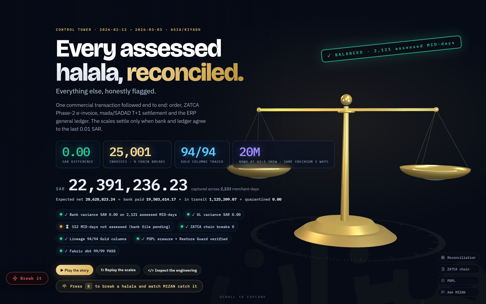

2. **City = Jeddah** - the heatmap and every KPI recompute from the semantic model.

   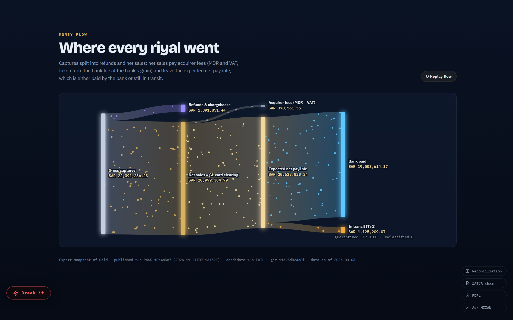

3. **One merchant-day, drilled** - every leg at once: captures, fees, bank paid, GL, both variances.

   

4. **Press `B`** - a planted halala break tilts the scale and the candidate run refuses to publish.

   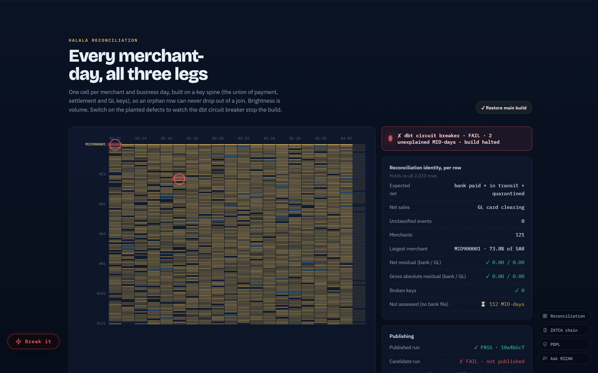

5. **ZATCA** - EGS cards, the outcome bar with the one rejection kept in the chain, the 24 h reporting window.

   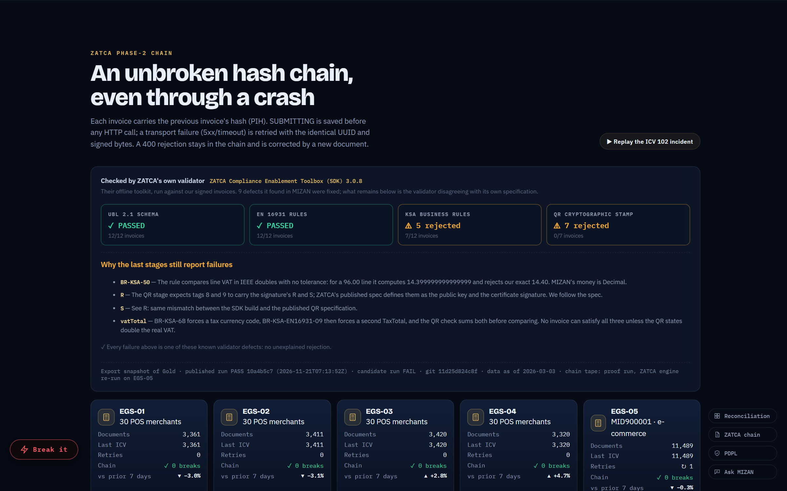

6. **The map** - stores by city, coloured by reconciliation status, routed to the acquirer and the bank.

   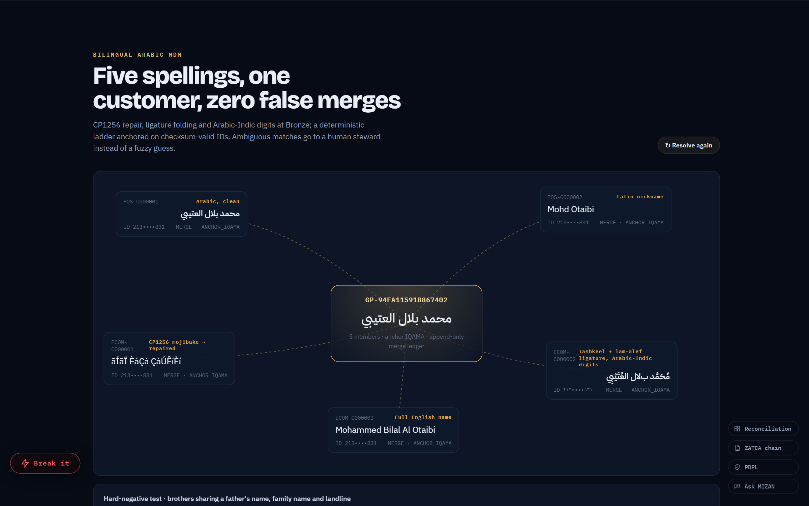

7. **Press `L`** - Arabic, right to left, while charts, IDs and numbers stay left to right.

   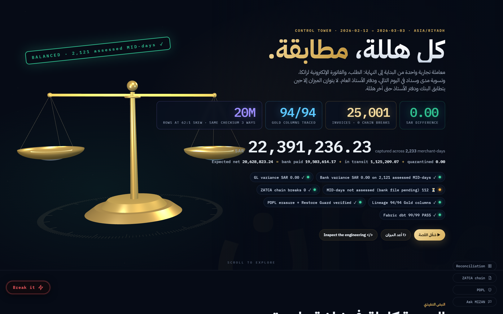

8. **The life cycle** - sources to Gold to the Control Tower, each box linked to its proof.

   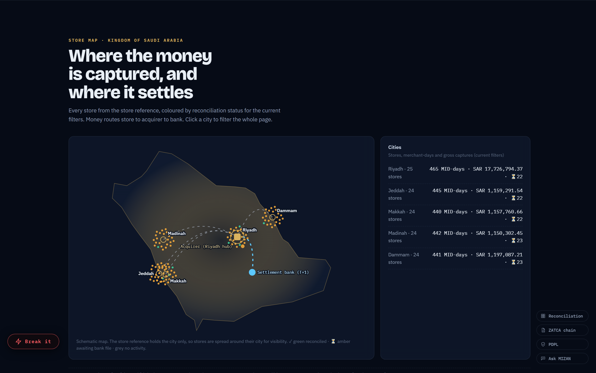

The screenshots are captured by `scripts/demo_shots.py` from the **standalone** page, which labels itself
*exported Gold snapshot* where the Fabric App says *Live*. Same code, same scenes, same figures; the label is
the honest difference and is left in the images.

Keys: `P` presenter mode, `1`-`9` scenes, `T` trace one riyal, `B` break a halala, `L` Arabic, `Ctrl K` jump.

## The four pillars

These are the engines. Everything after them exists to serve them, and each one is proven by a named artifact
rather than described.

### 1. ZATCA chain tape: zero ICV gaps, PIH continuity, one GL posting per sale (I-01 to I-04)

ICV 102 hits a transport timeout and the worker is killed in `SUBMITTING`. It recovers to `UNKNOWN_OUTCOME` and retries
the identical UUID and signed bytes until `REPORTED`. ICV 103 is rejected (HTTP 400) and stays in the chain, and the
correction is a new document with a new ICV.

### 2. Halala reconciliation: bank variance = GL variance = SAR 0.00 (I-05, I-06)
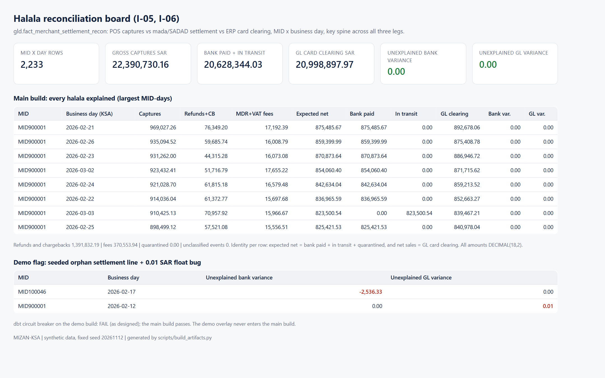
`gld.fact_merchant_settlement_recon` builds a key spine across captures, settlement and GL, so no orphan can drop out
of a join. The demo flag seeds an orphan bank line and a 0.01 float bug, and the dbt circuit breaker fails on exactly
those two MID-days. The main build stays green.

It rebuilds **incrementally** (ADR-015): only the merchant-days touched by data that arrived since the last run, found
by arrival time rather than business date — because in card payments the bank file for Tuesday lands on Thursday and a
chargeback can land 45 days late, so a "rebuild the last N days" window would silently stop reconciling exactly the
cases this model exists to catch. A touched day is deleted and re-derived in full, never appended to, and every test
in `tests/test_gold_incremental.py` builds both ways and demands the results match. The hard case is a bank line that
arrives *before* its payment: when the payment finally lands, that line stops being quarantined, but its own arrival
time never moves — so both reconciliation models carry a leg for it.

### 3. PDPL erasure with legal hold and Restore Guard (I-07, I-08)

One request erases all five linked records. Vault keys are NULL and VACUUMed, and the token-to-identity link is
removed. The signed ZATCA journal stays `LEGAL_HOLD_RETAINED` with tax totals unchanged. Restoring an old vault backup
plus a Silver snapshot is re-shredded by the Restore Guard.

### 4. Bilingual Arabic MDM: five spellings, one golden id, zero brother false-merges (I-09, I-10)
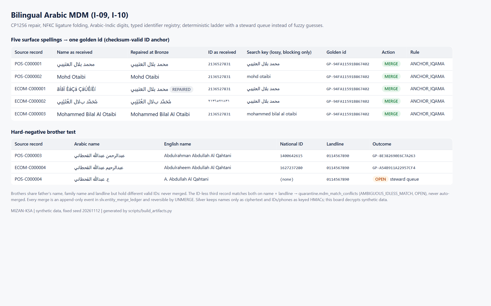

## Supporting platform engineering

Real work, deliberately ranked below the four pillars: the skew lab is a local benchmark, the streaming layer is
a deterministic replay harness rather than a live feed, open mirroring is demonstrated and not load-bearing
(ADR-014), and the Command Center is a presentation layer outside the frozen stack (ADR-011).

### 5. Spark skew: 65% mega-MID, AQE off vs AQE skew-join vs 16-bucket salting (I-11, I-12)
| AQE off: one task reads 13M rows | 16-bucket salted |
|---|---|
| 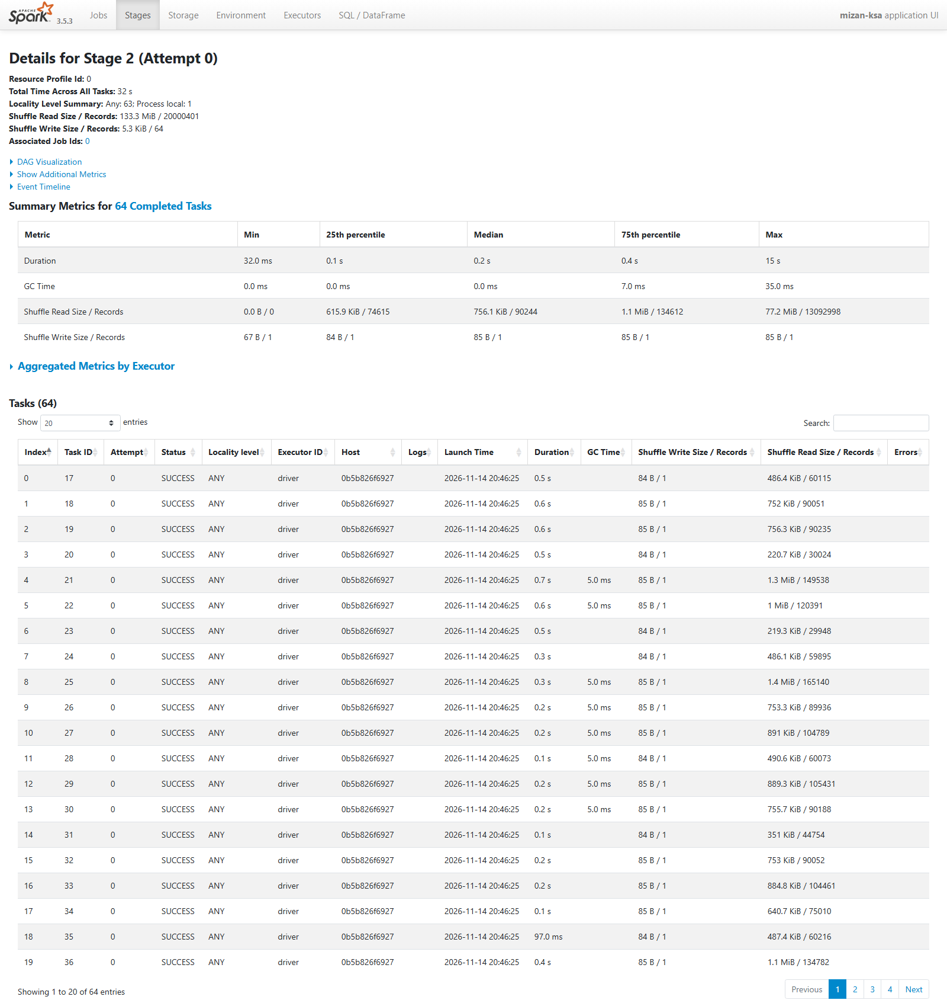 |  |

20M-row local Docker Spark run: the AQE-off straggler is 61.8x the median task (15.3 s vs 0.25 s); AQE skew-join
6.0x; salting caps the slowest task at 3.2 s. Rows and SAR checksum are identical in all three
([JSON](docs/artifacts/05_skew_benchmark_20m.json), [AQE skew-join UI](docs/artifacts/05_spark_ui_aqe_skew_join.png)).

**AQE won, and the benchmark says so.** Spark's own skew-join finished in 15.52 s against the hand-written
16-bucket salt's 17.62 s. Writing the salt by hand to beat a config flag would have been the wrong reason to write
it; the right reasons are that it is the only option left when AQE cannot split a partition - a stream-to-static
join, or a skewed pre-shuffle aggregation - and that implementing it is how you learn why the built-in is faster.
Both are kept in the repo for that comparison. **Read the skew ratios with care:** they are `max/median` task
duration, and the AQE run was measured over 5 tasks against the AQE-off run's 64, so the ratios describe different
distributions and are not directly comparable. The durations and the checksum are.

### 6. Orchestration and lineage (I-13, I-14)

Apache Airflow **inside Microsoft Fabric** (`AF_MIZAN`) runs the six lakehouse jobs over the Fabric REST API --
a real run, not a diagram: six tasks, 15 minutes, with the AI index and the NDMO catalogue in parallel.

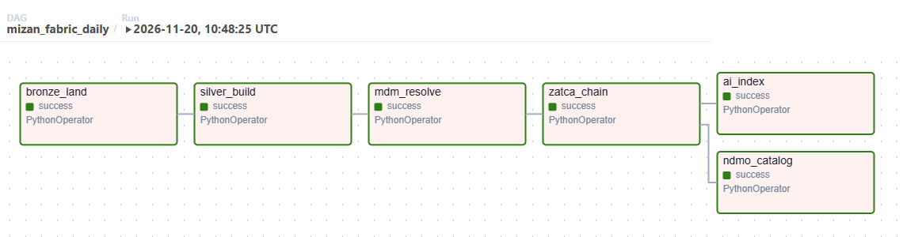

The item and the DAG are deployed by `scripts/fabric_airflow.py`, so the whole thing rebuilds from one command.
It runs on Fabric's starter pool, which pauses when idle, so the 03:00 schedule is written and proven by a manual
trigger but is not yet unattended -- see HONESTY.md row 30.

| Airflow DAG in Docker (adds the gates, dbt and lineage) | Marquez: Bronze to Gold, column level |
|---|---|
|  |  |

Every Gold column has lineage (94/94), and the build fails otherwise. Each run manifest carries `run_id`, `git_sha` and
Delta snapshot versions. The residency gate fails the build if a SECRET column targets an open zone.

### 7. Disaster recovery you can check, not just claim

A backup is a claim until someone restores from it. `scripts/dr_drill.py` fingerprints every Gold table,
rebuilds Gold, fingerprints again, and fails if one value moved. A DuckDB file is never byte-identical
between builds, so the fingerprint is SHA-256 over table *contents* in a canonical text form, sorted so
row order cannot matter.

```
.\.venv\Scripts\python.exe scripts\dr_drill.py                 # Gold from Silver (seconds)
.\.venv\Scripts\python.exe scripts\dr_drill.py --from source   # from the fixed seed (minutes)
```

The drill records its own RTO and writes `docs/artifacts/13_dr_drill.json`. `tests/test_dr_drill.py`
proves it is sensitive to **one halala**: change an amount by 0.01 and the fingerprint changes; change
it back and the fingerprint returns. A restore check blind to a halala would prove nothing on this
project.

### 8. MIZAN Command Center: the cinematic control tower
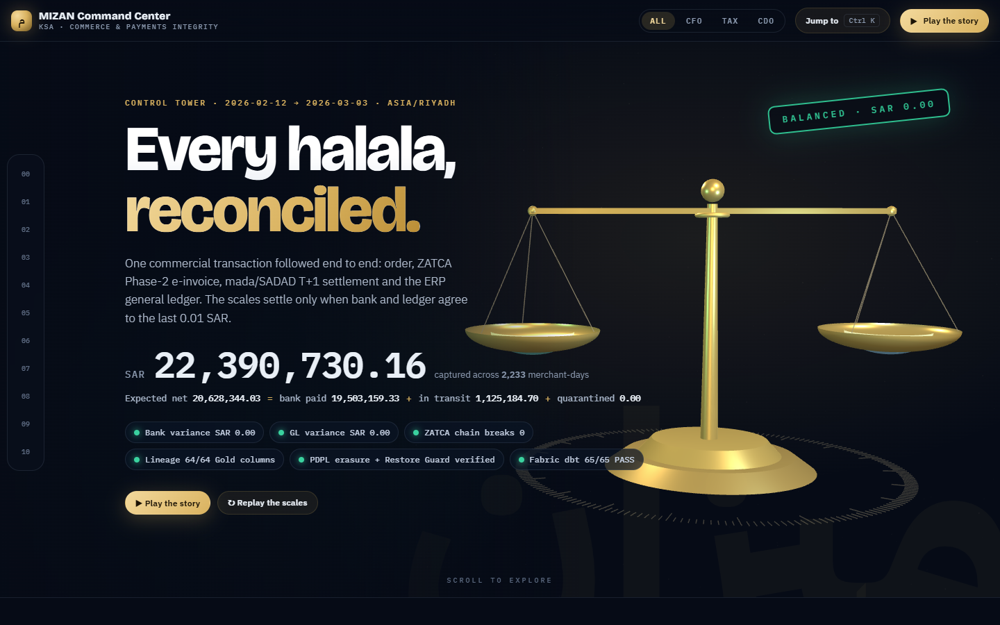
A golden balance scale fills with captures first and the bank file a day later (T+1), then settles exactly level when
bank and GL variance reach SAR 0.00. Ten scenes follow, each with a story-mode narration: executive pulse, money
flow, the daily ledger on the Umm al-Qura calendar, the halala heatmap (switch on the planted defects and the circuit
breaker halts the build), the ZATCA chain with an incident replay, PDPL erasure theatre, Arabic MDM resolution, the
risk stream replay, lineage and NDMO, and the Spark skew race. CFO, Tax and CDO role views; `Ctrl K` command palette.

| Money flow | Halala heatmap with planted defects | ZATCA chain and incident |
|---|---|---|
| 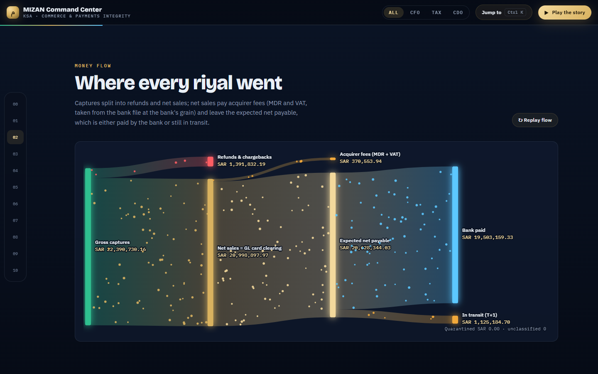 | 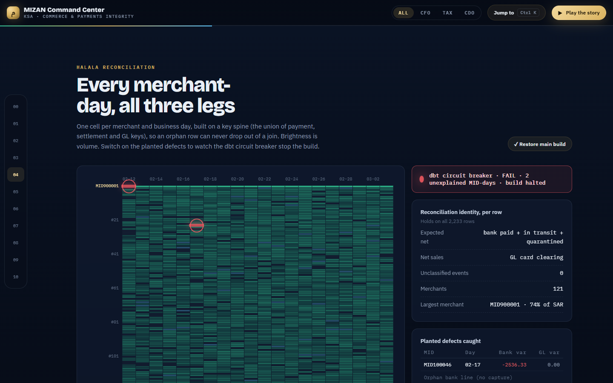 | 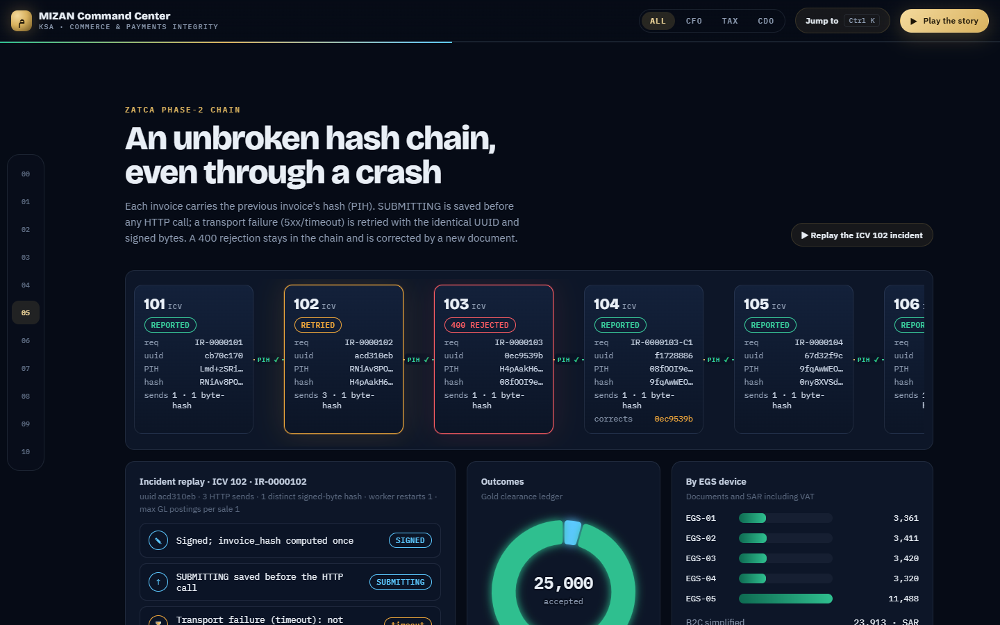 |

Every figure is exported by `scripts/build_command_center.py` from Gold and the proof runs; money stays exact as
integer halalas, and `tests/test_command_center.py` checks the identities, masking and pinned scripts. Open
`command_center/index.html` locally, or ask for the private link. Power BI remains the governed report (ADR-011).

## Data residency, and where this deployment does not match its own policy

Every regulated Saudi workload gets asked this in the first meeting, so it is answered here rather than left to
be discovered.

`config/residency_policy.yml` declares a ceiling per zone and an approved region, and `residency_gate` in the
Airflow DAG **fails the pipeline** when a column's NDMO tier exceeds what its zone may hold, or when SECRET or
TOP_SECRET data sits outside an approved region. `security` and `audit` may hold TOP_SECRET; `WH_MIZAN.gld` is
capped at CONFIDENTIAL precisely because BI users read it; `EXPORT.open_data` is PUBLIC only.

**The honest part: the policy says `region: KSA` for every zone, and this deployment runs in UAE North.** The
policy describes the intended production placement — in-Kingdom, which is what SAMA and NDMO expectations point
to for a workload like this — while the Fabric trial capacity available here is UAE North. The gate therefore
passes against the intent, not against the deployed reality, and that is a gap rather than a subtlety. Moving to
Azure Saudi Arabia (Dammam) is a capacity and workspace-region change plus a provisioning re-run; the policy
file itself would not change, because it already says KSA.

**Cost.** Not stated, because it has not been measured. Capacity Unit consumption has to come from the Fabric
Capacity Metrics app against a real run, and an estimate typed from a pricing page would be the kind of number
this project exists to refuse. The full local pipeline (Bronze + Silver + ZATCA) runs in about six minutes and
Gold rebuilds in 18.2 s, which bounds the work but is not a CU figure.

## Results on Microsoft Fabric

Workspace `mizan-ksa-dev`, Fabric trial capacity (UAE North). Evidence: [docs/artifacts/10_fabric_run_evidence.json](docs/artifacts/10_fabric_run_evidence.json).

| Check | Result |
|---|---|
| Notebook jobs (Bronze, Silver, MDM, ZATCA, AI index, NDMO catalog) via REST + service principal | all Completed |
| Source-to-Bronze hash reconciliation | every file sha256 matches; duplicate bank resend = ALL_DUPLICATE |
| `dbt build` on WH_MIZAN (dbt-fabric, Gold as physical tables, reads `LH_MIZAN.slv.*`) | **99/99 PASS**, 2026-11-21 - full parity with the local target. A second run took the incremental `delete+insert` path on T-SQL and stayed 99/99 |
| `gld.fact_merchant_settlement_recon` | 2,233 MID-days, SAR 22,391,236.23 captured, bank + GL variance 0.00 - identical to local Gold |
| ZATCA chain | 25,001 documents, 0 chain violations, 1 worker restart recovered |
| MDM | 3,985 records into 2,552 golden profiles, 1 steward conflict |
| Power BI Control Tower (Direct Lake TMDL model + 3-page PBIR report, created by API) | DAX returns the same totals |
| Fabric App `command-center` (Rayfin Data App, protected) | 5 DAX queries replace the embedded data; results equal the Gold export (tests) |
| Streaming replay: Eventstream ES_MIZAN -> Eventhouse EH_MIZAN | 91,513 events landed (23,511 checkout, 50,002 invoice, 18,000 payment); KQL rules fire exactly as local: velocity 1, mule ring 1, reporting-SLA breaches 2 |

One portal-only item is listed in [docs/PORTAL_STEPS.md](docs/PORTAL_STEPS.md): the Fabric Data Agent, which
Microsoft does not allow on trial capacities.

## Architecture

```
SOURCES (100K synthetic rows, 12 planted defects): POS (5 EGS) | e-com orders | mada/SADAD T+1 files | ERP ACDOCA | CRM/SPL (CP1256 + UTF-8)
   v  encrypt-on-land (HMAC-SHA256 subject token + AES-256-GCM per-subject DEK)
LH_MIZAN  brz  ctl (watermarks, applied-event ledger, EGS chain state, invoice outbox, tombstones)
          slv  (zatca_invoice_documents, payment_lifecycle, settlement_lines, erp_gl_journal_lines,
                golden_party_scd2, identifier_registry, entity_merge_ledger, address_observations)
          quarantine | security (vault, token map) | audit (signed ZATCA journal, DSR evidence, run manifests, benchmarks)
          meta (NDMO column_classification) | ai (policy_chunks, agent_audit_log)
   v  dbt-fabric, freshness-gated, three-part names
WH_MIZAN  gld: fact_merchant_settlement_recon | fact_zatca_clearance_ledger | dim_party_golden | dim_date_saudi | mart_ndmo_scorecard
   v
Direct Lake Control Tower (CFO Settlement | Tax ZATCA Health | CDO Data Trust) | governed AI | EH_MIZAN KQL risk stream
```

Design decisions are in [docs/adr/](docs/adr/) (ADR-001 to ADR-016); the 14 invariants are in
[invariants.md](invariants.md).

### The diagrams

Six, in [docs/diagrams/](docs/diagrams/), built by `scripts/build_diagrams.py`. Two of them are derived
rather than drawn: the dbt lineage is read out of `dbt/target/manifest.json`, and the schema map's table
names come from what `src/mizan/spark/*.py` actually writes. Neither can describe a shape the code does
not have.

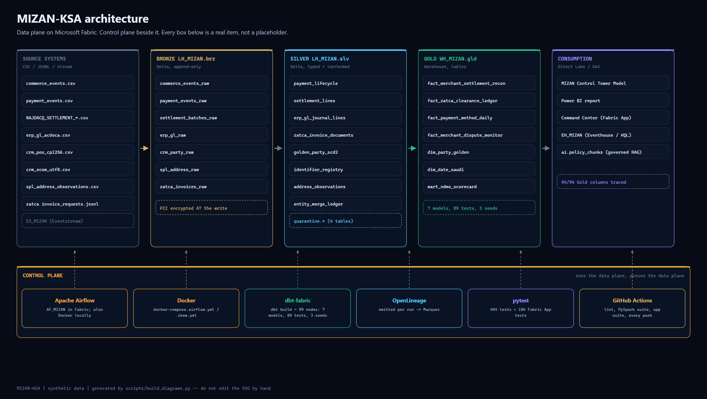

| | |
|---|---|
| [One sale, five systems](docs/diagrams/png/02_dataflow_one_sale.png) | the same SAR 138.00 purchase as the till, the card, the tax authority, the bank and the ledger each record it |
| [The schema map](docs/diagrams/png/03_schema_map.png) | eight lakehouse schemas, `gld`, and the rules that are not negotiable |
| [The ZATCA state machine](docs/diagrams/png/04_zatca_state_machine.png) | every edge labelled with its HTTP status, and what a non-definitive answer forces |
| [The reconciliation spine](docs/diagrams/png/05_reconciliation_spine.png) | why it is a UNION spine and not a LEFT JOIN |
| [dbt lineage](docs/diagrams/png/06_dbt_lineage.png) | 7 models over their inputs, generated from the manifest |

The same six are published into Fabric by `scripts/fabric_walkthrough.py`, which builds
**`nb_mizan_walkthrough`** in the workspace: each diagram sits above a cell that queries `LH_MIZAN` and
`WH_MIZAN` live, so the picture and the evidence for it are on one screen inside the tenant.

### Operating it, and how far it is from production

| | |
|---|---|
| [docs/RUNBOOKS.md](docs/RUNBOOKS.md) | What to do when it breaks at 03:00. Ten failures that can actually happen, including the two that must **not** be answered by re-running. Alerts link to a heading here, and a test fails the build if one ever points at a heading that does not exist. |
| [docs/compliance/DPIA.md](docs/compliance/DPIA.md) | A data protection impact assessment, self-assessed and explicitly **not legally reviewed**, with nine residual risks ranked and three of them still open. |
| [docs/PROJECT_IN_PLAIN_ENGLISH.md](docs/PROJECT_IN_PLAIN_ENGLISH.md) | The whole system explained without jargon, and an honest answer to "is this production ready?" -- which is **no**, with the four things that are already production-grade and the seven that are missing. |

The close has a stated deadline (06:00 Asia/Riyadh), a task that measures it and reports a breach, and
`scripts/backfill.py` is a re-run procedure that fingerprints Gold before and after: its last run reported
10/10 Gold tables identical. There is still nobody on call, and the runbooks say so.

## Run it

### Local (Windows)
```powershell
python -m venv .venv
.\.venv\Scripts\python.exe -m pip install -e ".[dev,spark,dbt]"
.\.venv\Scripts\python.exe scripts\init_local_env.py                     # dev keys + Airflow password into .env (git-ignored)
.\.venv\Scripts\python.exe -m mizan.generator --out data/generated      # ~100K rows, fixed seed, byte-identical reruns
.\.venv\Scripts\python.exe -m mizan.spark.pipeline --lake data/lake      # Bronze, Silver, MDM, ZATCA, AI index, NDMO catalog
cd dbt; $env:MIZAN_LAKE_ROOT="../data/lake"; ..\.venv\Scripts\dbt.exe build --profiles-dir . --target duckdb; cd ..
.\.venv\Scripts\python.exe -m pytest -q                                  # 250 tests, ~15 min; -m "not spark" for ~30 s
```

### Docker
```powershell
docker compose -f docker/docker-compose.skew.yml run --rm --service-ports spark-bench   # 20M-row skew benchmark
docker compose -f docker/docker-compose.airflow.yml up -d --build                       # Airflow :8080, Marquez :3000
.\.venv\Scripts\python.exe -m mizan.lineage.openlineage --duckdb tmp/mizan_gold.duckdb --lake data/lake
```

### Microsoft Fabric
```powershell
.\.venv\Scripts\python.exe scripts\fabric_provision.py        # workspace + LH_MIZAN (schemas) + WH_MIZAN + EH_MIZAN + ES_MIZAN
.\.venv\Scripts\python.exe scripts\fabric_deploy.py upload    # code, policies, data to OneLake
.\.venv\Scripts\python.exe scripts\fabric_deploy.py run       # every step as a Fabric notebook job (service principal)
cd dbt; ..\.venv\Scripts\dbt.exe build --profiles-dir . --target fabric; cd ..
.\.venv\Scripts\python.exe scripts\fabric_streaming.py setup; .\.venv\Scripts\python.exe scripts\fabric_streaming.py replay
.\.venv\Scripts\python.exe scripts\fabric_powerbi.py          # Direct Lake model + Control Tower report
cd apps\command-center; npm ci; npx rayfin login; npx rayfin up   # the Command Center as a Fabric App
```
Credentials come only from the git-ignored `.env` (see `.env.example`).

## Repository

| Path | Contents |
|------|----------|
| `src/mizan/` | generator, ZATCA engine (`clearance`), Bronze/Silver/MDM/PDPL/skew on Spark (`spark`), MDM, privacy, governance, governed AI, streaming, lineage, orchestration |
| `dbt/` | Gold models, tests, Umm al-Qura seed, lineage overrides (one SQL for DuckDB and dbt-fabric) |
| `airflow/dags/` | `mizan_daily` outer DAG: Fabric jobs, freshness and residency gates, dbt, OpenLineage to Marquez (Docker) |
| `dags/` | `mizan_fabric_daily`, the six lakehouse jobs scheduled by Fabric's own Airflow job ([setup](docs/FABRIC_AIRFLOW.md)) |
| `docker/` | Spark benchmark image, Airflow + Marquez compose |
| `kql/` | EH_MIZAN table, mapping and rule functions |
| `powerbi/` | TMDL semantic model and PBIR report definitions |
| `command_center/` | Cinematic web control tower (template, exported data snapshot, standalone page) |
| `apps/command-center/` | The same Command Center as a Fabric App (Rayfin Data App): live DAX, filters, map |
| `scripts/` | Fabric provisioning/deploy/airflow/streaming/Power BI, artifact builder, seed builders |
| `tests/` | 250 tests, one or more per invariant |
| `docs/` | ADRs, policies, streaming guide, portal steps, artifacts |
