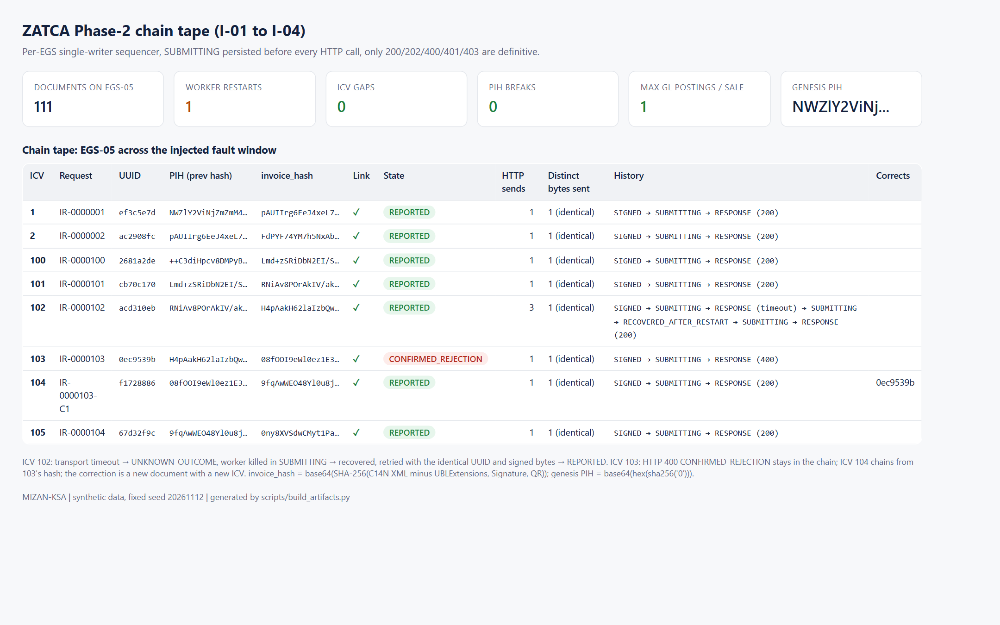
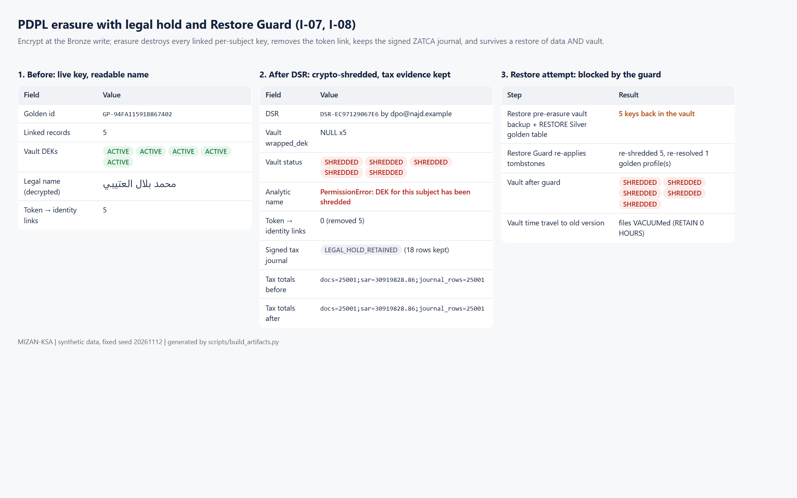
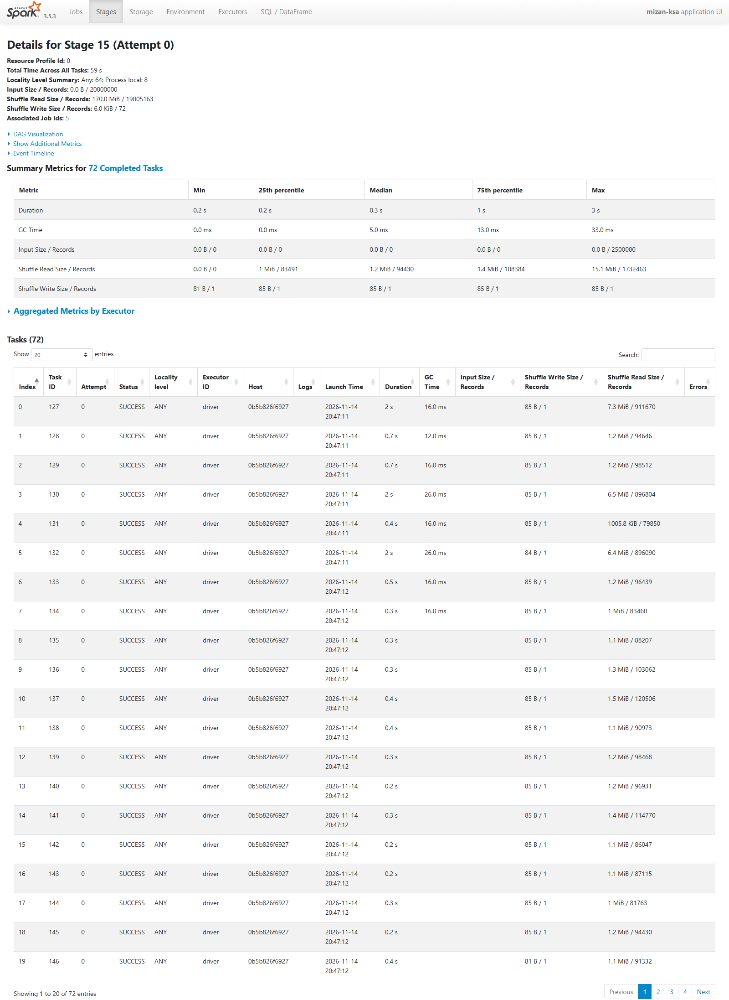
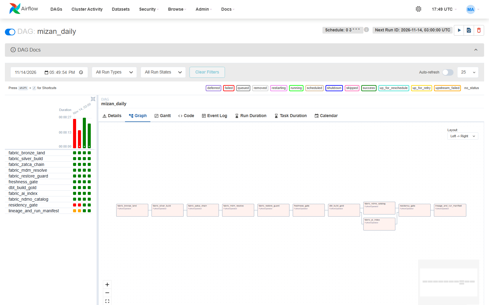
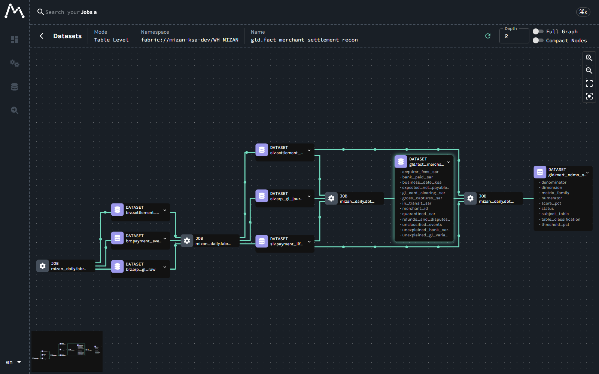

# MIZAN-KSA: Saudi Regulated Commerce & Payments Data Integrity Platform

*MIZAN* is Arabic for "the balance / the scales".

MIZAN-KSA follows one commercial transaction end to end: order capture, ZATCA Phase-2 e-invoice, mada/SADAD T+1 bank
settlement, and an ACDOCA-shaped ERP general ledger. Every halala (0.01 SAR) reconciles. Every invoice chain stays
intact through transport failures (5xx/timeout) and worker crashes. Every customer's PII is encrypted when it lands
and can be erased under PDPL without touching signed tax evidence. It runs locally and on **Microsoft Fabric**.

**Stack:** Microsoft Fabric (OneLake Delta `LH_MIZAN`, PySpark notebooks, Warehouse `WH_MIZAN`, Eventhouse/Eventstream,
Direct Lake Power BI) as the data plane; Apache Airflow, dbt-fabric, OpenLineage + Marquez, pytest, Docker and GitHub
Actions as the control plane. 221 automated tests; CI runs the full PySpark + dbt suite on every push.

> Scope and limits are stated in [HONESTY.md](HONESTY.md). It is a standards-informed engineering reference
> architecture on synthetic data, not a regulator-certified tax product.

## Proof artifacts

### 1. ZATCA chain tape: zero ICV gaps, PIH continuity, one GL posting per sale (I-01 to I-04)

ICV 102 hits a transport timeout and the worker is killed in `SUBMITTING`. It recovers to `UNKNOWN_OUTCOME` and retries
the identical UUID and signed bytes until `REPORTED`. ICV 103 is rejected (HTTP 400) and stays in the chain, and the
correction is a new document with a new ICV.

### 2. Halala reconciliation: bank variance = GL variance = SAR 0.00 (I-05, I-06)

`gld.fact_merchant_settlement_recon` builds a key spine across captures, settlement and GL, so no orphan can drop out
of a join. The demo flag seeds an orphan bank line and a 0.01 float bug, and the dbt circuit breaker fails on exactly
those two MID-days. The main build stays green.

### 3. PDPL erasure with legal hold and Restore Guard (I-07, I-08)

One request erases all five linked records. Vault keys are NULL and VACUUMed, and the token-to-identity link is
removed. The signed ZATCA journal stays `LEGAL_HOLD_RETAINED` with tax totals unchanged. Restoring an old vault backup
plus a Silver snapshot is re-shredded by the Restore Guard.

### 4. Bilingual Arabic MDM: five spellings, one golden id, zero brother false-merges (I-09, I-10)


### 5. Spark skew: 65% mega-MID, AQE off vs AQE skew-join vs 16-bucket salting (I-11, I-12)
| AQE off: one task reads 13M rows | 16-bucket salted |
|---|---|
|  |  |

20M-row local Docker Spark run: the AQE-off straggler is 61.8x the median task (15.3 s vs 0.25 s); AQE skew-join
6.0x; salting caps the slowest task at 3.2 s. Rows and SAR checksum are identical in all three
([JSON](docs/artifacts/05_skew_benchmark_20m.json), [AQE skew-join UI](docs/artifacts/05_spark_ui_aqe_skew_join.png)).

### 6. Orchestration and lineage (I-13, I-14)
| Airflow DAG (Fabric jobs, freshness gate, dbt, residency gate) | Marquez: Bronze to Gold, column level |
|---|---|
|  |  |

Every Gold column has lineage (64/64), and the build fails otherwise. Each run manifest carries `run_id`, `git_sha` and
Delta snapshot versions. The residency gate fails the build if a SECRET column targets an open zone.

## Results on Microsoft Fabric

Workspace `mizan-ksa-dev`, Fabric trial capacity (UAE North). Evidence: [docs/artifacts/10_fabric_run_evidence.json](docs/artifacts/10_fabric_run_evidence.json).

| Check | Result |
|---|---|
| Notebook jobs (Bronze, Silver, MDM, ZATCA, AI index, NDMO catalog) via REST + service principal | all Completed |
| Source-to-Bronze hash reconciliation | every file sha256 matches; duplicate bank resend = ALL_DUPLICATE |
| `dbt build` on WH_MIZAN (dbt-fabric, Gold as tables, reads `LH_MIZAN.slv.*`) | 65/65 PASS |
| `gld.fact_merchant_settlement_recon` | 2,233 MID-days, SAR 22,390,730.16 captured, bank + GL variance 0.00 |
| ZATCA chain | 25,001 documents, 0 chain violations, 1 worker restart recovered |
| MDM | 3,985 records into 2,552 golden profiles, 1 steward conflict |
| Power BI Control Tower (Direct Lake TMDL model + 3-page PBIR report, created by API) | DAX returns the same totals |
| Streaming replay into Eventstream ES_MIZAN | 91,513 events accepted |

Two portal-only items are listed in [docs/PORTAL_STEPS.md](docs/PORTAL_STEPS.md): the Eventstream to Eventhouse
delivery check, and the Fabric Data Agent, which Microsoft does not allow on trial capacities.

## Architecture

```
SOURCES (100K synthetic rows, 12 planted defects): POS (5 EGS) | e-com orders | mada/SADAD T+1 files | ERP ACDOCA | CRM/SPL (CP1256 + UTF-8)
   v  encrypt-on-land (HMAC-SHA256 subject token + AES-256-GCM per-subject DEK)
LH_MIZAN  brz  ctl (watermarks, applied-event ledger, EGS chain state, invoice outbox, tombstones)
          slv  (zatca_invoice_documents, payment_lifecycle, settlement_lines, erp_gl_journal_lines,
                golden_party_scd2, identifier_registry, entity_merge_ledger, address_observations)
          quarantine | security (vault, token map) | audit (signed ZATCA journal, DSR evidence, run manifests, benchmarks)
          meta (NDMO column_classification) | ai (policy_chunks, agent_audit_log)
   v  dbt-fabric, freshness-gated, three-part names
WH_MIZAN  gld: fact_merchant_settlement_recon | fact_zatca_clearance_ledger | dim_party_golden | dim_date_saudi | mart_ndmo_scorecard
   v
Direct Lake Control Tower (CFO Settlement | Tax ZATCA Health | CDO Data Trust) | governed AI | EH_MIZAN KQL risk stream
```

Design decisions are in [docs/adr/](docs/adr/) (ADR-001 to ADR-010); the 14 invariants are in
[invariants.md](invariants.md).

## Run it

### Local (Windows)
```powershell
python -m venv .venv
.\.venv\Scripts\python.exe -m pip install -e ".[dev,spark,dbt]"
.\.venv\Scripts\python.exe scripts\init_local_env.py                     # dev keys + Airflow password into .env (git-ignored)
.\.venv\Scripts\python.exe -m mizan.generator --out data/generated      # ~100K rows, fixed seed, byte-identical reruns
.\.venv\Scripts\python.exe -m mizan.spark.pipeline --lake data/lake      # Bronze, Silver, MDM, ZATCA, AI index, NDMO catalog
cd dbt; $env:MIZAN_LAKE_ROOT="../data/lake"; ..\.venv\Scripts\dbt.exe build --profiles-dir . --target duckdb; cd ..
.\.venv\Scripts\python.exe -m pytest -q                                  # 221 tests, ~15 min; -m "not spark" for ~30 s
```

### Docker
```powershell
docker compose -f docker/docker-compose.skew.yml run --rm --service-ports spark-bench   # 20M-row skew benchmark
docker compose -f docker/docker-compose.airflow.yml up -d --build                       # Airflow :8080, Marquez :3000
.\.venv\Scripts\python.exe -m mizan.lineage.openlineage --duckdb tmp/mizan_gold.duckdb --lake data/lake
```

### Microsoft Fabric
```powershell
.\.venv\Scripts\python.exe scripts\fabric_provision.py        # workspace + LH_MIZAN (schemas) + WH_MIZAN + EH_MIZAN + ES_MIZAN
.\.venv\Scripts\python.exe scripts\fabric_deploy.py upload    # code, policies, data to OneLake
.\.venv\Scripts\python.exe scripts\fabric_deploy.py run       # every step as a Fabric notebook job (service principal)
cd dbt; ..\.venv\Scripts\dbt.exe build --profiles-dir . --target fabric; cd ..
.\.venv\Scripts\python.exe scripts\fabric_streaming.py setup; .\.venv\Scripts\python.exe scripts\fabric_streaming.py replay
.\.venv\Scripts\python.exe scripts\fabric_powerbi.py          # Direct Lake model + Control Tower report
```
Credentials come only from the git-ignored `.env` (see `.env.example`).

## Repository

| Path | Contents |
|------|----------|
| `src/mizan/` | generator, ZATCA engine (`clearance`), Bronze/Silver/MDM/PDPL/skew on Spark (`spark`), MDM, privacy, governance, governed AI, streaming, lineage, orchestration |
| `dbt/` | Gold models, tests, Umm al-Qura seed, lineage overrides (one SQL for DuckDB and dbt-fabric) |
| `airflow/dags/` | `mizan_daily` outer DAG |
| `docker/` | Spark benchmark image, Airflow + Marquez compose |
| `kql/` | EH_MIZAN table, mapping and rule functions |
| `powerbi/` | TMDL semantic model and PBIR report definitions |
| `scripts/` | Fabric provisioning/deploy/streaming/Power BI, artifact builder, seed builders |
| `tests/` | 221 tests, one or more per invariant |
| `docs/` | ADRs, policies, streaming guide, portal steps, artifacts |
